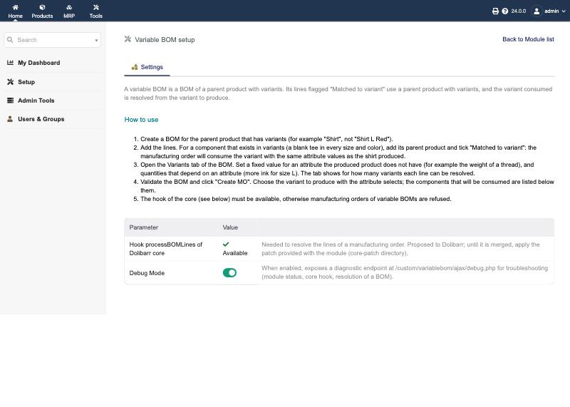
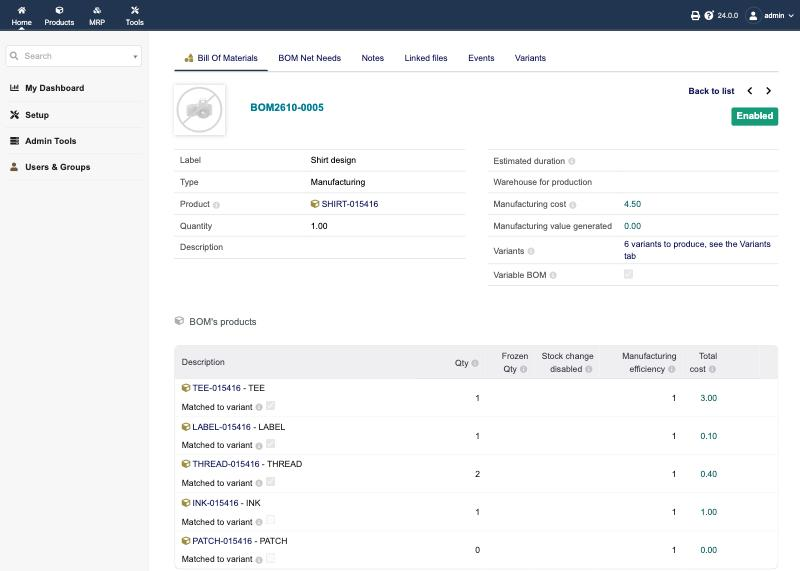
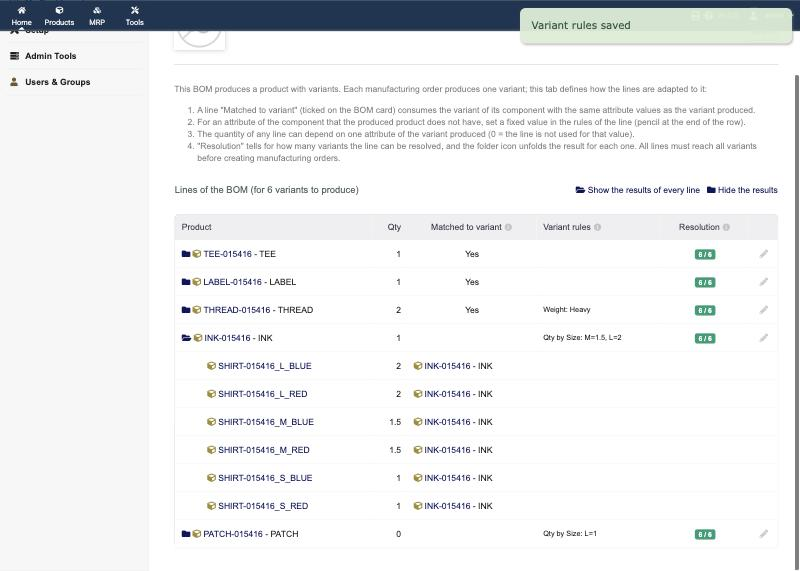
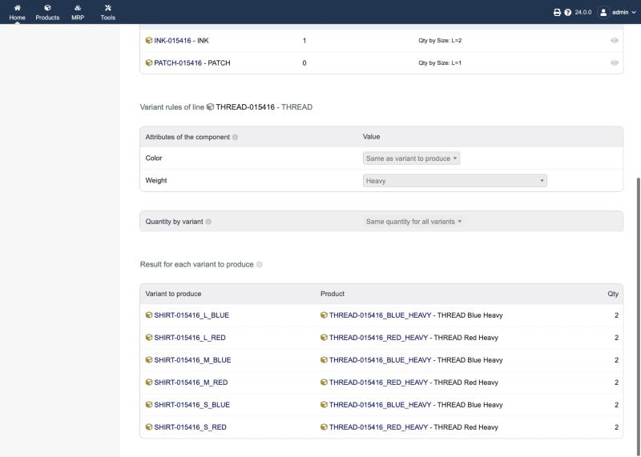
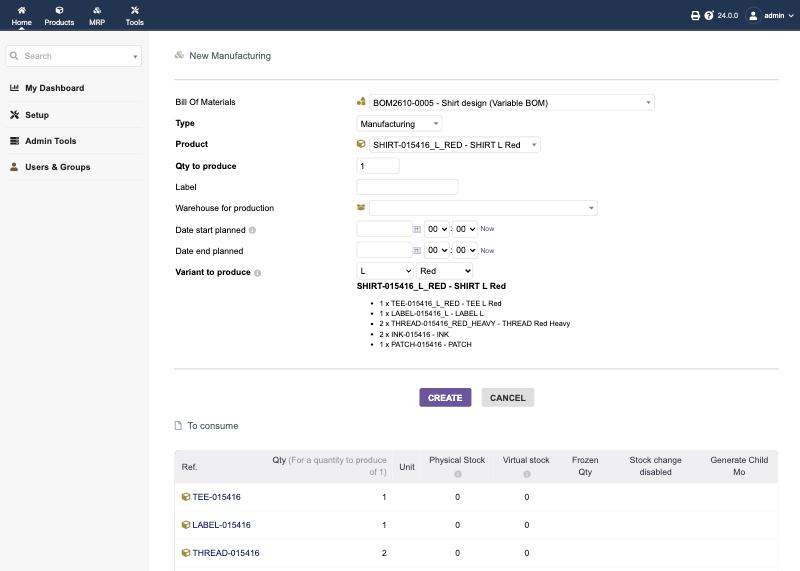

# Variable BOM for Dolibarr

**One bill of materials for every variant of a product.**

If you make a T-shirt in three sizes and two colours, Dolibarr normally needs six bills of materials (BOMs), one per
variant, and six more every time you add a design. This module lets you keep **one BOM on the parent product**. When you
create a manufacturing order, you pick the size and colour, and the module works out which blank tee, which thread and how
much ink that order consumes.

| Line of the "Shirt" BOM | How it is set up | What an order for a shirt **L / Red** consumes |
|---|---|---|
| Blank tee (exists in every size × colour) | *Matched to variant* | Blank tee L / Red |
| Neck label (exists per size) | *Matched to variant* | Neck label L |
| Thread (exists per colour × weight) | *Matched to variant*, fixed value Weight = Heavy | Thread Red / Heavy |
| Ink | Quantity by Size: L = 2 | 2 × Ink |
| Back patch | Quantity 0, by Size: L = 1 | 1 × Back patch (not used for S and M) |

Works with Dolibarr **24.0 or newer**, with the modules **BOM**, **Manufacturing Orders** and **Product variants** enabled.

---

## 1. Install

### Step 1: add the hook to Dolibarr (once)

The module needs one small addition to a Dolibarr core file, `htdocs/mrp/class/mo.class.php`. It has been proposed to
the Dolibarr project; until it is part of a release, add it yourself. Pick one way:

- **Replace the file** (no command line needed). Find your exact Dolibarr version (Home > Setup > Other setup > About, or
  the version at the bottom of any page), then follow [core-patch/full-file/README.md](core-patch/full-file/README.md):
  rename your `mo.class.php` to `mo.class.php.orig` and copy the file for your version in its place.
- **Run the script** (any 24.0.x). It checks the file before touching it and keeps a backup:
  ```bash
  php core-patch/apply_hook.php /path/to/dolibarr/htdocs
  ```
- **Git users:** `git apply core-patch/processBOMLines-24.0.patch`.

Without the hook, the module still installs, but it **refuses** manufacturing orders of variable BOMs rather than consuming
the wrong products. The module's setup page tells you whether the hook is present.

### Step 2: install and enable the module

Home > Setup > Modules/Applications > **Deploy/install external app/module**, and upload `variablebom-1.2.0.zip`
(or copy the `module` folder to `htdocs/custom/variablebom`). Then enable **Variable BOM** in the module list.

Open its setup page (the gear icon next to the module). It shows **How to use** and whether the hook is available:



---

## 2. Set up a variable BOM

### 2.1 Create the BOM on the parent product

Create a BOM as usual, but choose the **parent** product, the one that has variants ("Shirt", not "Shirt L Red").
The BOM card then shows **Variable BOM: Yes, for N variants**, with a link to the Variants tab.

### 2.2 Add the lines, and tick "Matched to variant" where the component has variants

Every line has a **Matched to variant** checkbox:

- **Tick it** when the component exists in variants (a blank tee in every size and colour). Add the component's **parent**
  product on the line. The order will consume the variant with the same attribute values as the shirt produced.
- **Leave it unticked** for a plain component (ink, a box). The same product is consumed for every variant; only its
  quantity can change (see 2.3).

The module refuses to tick a line whose product has no variants, or on a BOM whose product has no variants.



### 2.3 Open the Variants tab and complete the rules

The **Variants** tab lists every line with its rules and a **Resolution** badge: green `6 / 6` when the line can be
resolved for every variant to produce, orange when some cannot. The folder icon in front of a line unfolds what that line
becomes for each variant (the links above the table unfold or fold them all). Click the pencil at the end of a row to
edit the line's rules in place, with Save and Cancel right there, like a document line. As with the BOM's own lines, the
rules can only be edited while the BOM is in **Draft**: on a validated BOM the tab says so and shows them read-only
(click "Back to draft" on the BOM card to change them, then validate again).



For each line you can set:

- **Attributes of the component** (matched lines only). Each attribute of the component either follows the variant
  produced ("Same as variant to produce") or always takes one value. A fixed value is **required** for an attribute the
  produced product does not have: thread comes in Light/Heavy but a shirt has no Weight, so pick Heavy. Until you do,
  the line shows a warning and "Resolved for 0 of 6 variants".
- **Quantity by variant** (any line). Choose the attribute of the produced product that changes the quantity, then enter a
  quantity for each of its values. Empty means the line's own quantity; **0 means the line is not used** for that value.
  To use a line for some sizes only, set its quantity to 0 on the BOM card and enter a quantity for those sizes here.

While a line is being edited, its results for every variant stay unfolded under it, so you can check the effect of the
rules right after saving.



Every line should reach "Resolved for N of N variants" before you create orders. If one does not, open its rules: an
attribute needs a fixed value, or the component does not exist in that variant.

---

## 3. Create a manufacturing order

Validate the BOM and click **Create MO**. In the BOM list, variable BOMs are marked **(Variable BOM)**.
A **Variant to produce** row appears: choose one value per attribute. The product to produce is filled in for you,
and the components that will be consumed are listed under the selects.



Click **Create**: the order's lines are the resolved components. The same resolution applies when you click
**Reinitialize** on a draft order, when an order is created through the REST API, and to variable sub-BOMs.

If you try to create an order without choosing a variant, or for the parent product itself, the module refuses it with
an explanation.

---

## 4. Troubleshooting

| What you see | What it means | What to do |
|---|---|---|
| Setup page: hook "missing"; orders of variable BOMs refused | The core file has not been patched, or a Dolibarr upgrade replaced it | Redo Step 1 of the installation |
| "A line can be matched to variant only if its product is a parent product with variants" | The line's product is a variant or a plain product | Put the component's parent product on the line, or leave the box unticked |
| "Resolved for 0 of N variants" on a line | An attribute of the component has no value for the shirt | Open the rules of the line and set a fixed value |
| "Component X: no variant exists for Size=XL, Color=Red" | That combination of the component was never created | Create the missing variant of the component, or set a fixed value |
| Order lines show the parent products | The hook is missing and the module is disabled | Enable the module and check the hook |

Admins can turn on **Debug Mode** in the setup page: `/custom/variablebom/ajax/debug.php?mode=bom&id=<BOM id>` prints the
resolution of every line for every variant.

## 5. Upgrading, uninstalling

- **After a Dolibarr upgrade**, the patched core file is replaced by the new release's copy: redo Step 1 of the installation.
- **Disabling the module** keeps its rules and the "Matched to variant" flags; enable it again and everything is back.
  Orders of variable BOMs created while the module is disabled would consume the parent products.

## 6. Known limitations

- Cloning a BOM does not copy the "Matched to variant" flags nor the rules (the core clone does not copy line extrafields).
- The core's own "To consume" list on the order creation form shows the BOM lines as defined; the resolved components are
  shown under the variant selects.
- The manufacturing cost shown on a variable BOM is computed by the core from the parent products of the lines.
- Only English texts are provided for now.

## 7. For developers

`docker compose up -d` starts Dolibarr 24.0 on http://localhost:8080 (admin / admin) with the hook applied and the module
mounted from `module/`. End-to-end test (creates demo products, BOMs and orders, so not for production):

```bash
docker compose cp dev/test_variablebom.php dolibarr:/tmp/ && docker compose exec -u www-data dolibarr php /tmp/test_variablebom.php
```

How the module plugs in: the hook `processBOMLines` added to `Mo::processBOM()` lets the module replace the BOM lines
with the resolved ones when an order's lines are built. The resolution itself is in `class/variablebomresolver.class.php`;
the rules live in the table `llx_variablebom_rule`, and the "Matched to variant" flag is an extrafield of BOM lines.
`core-patch/apply_hook.php` is generated from the same strings as the proposed core change; `dev/build_full_files.sh`
rebuilds the ready-made files for new Dolibarr releases.

Module ID 194281 (range 194281–194309 reserved by Zach Melo). License GPL v3 or later.
